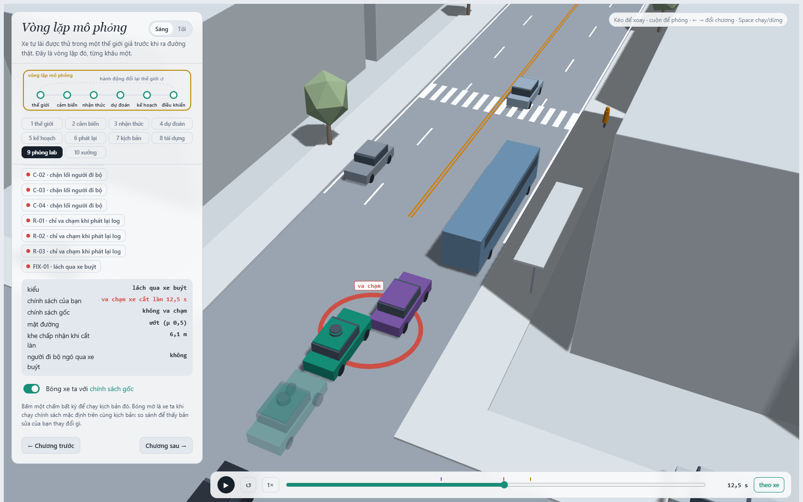
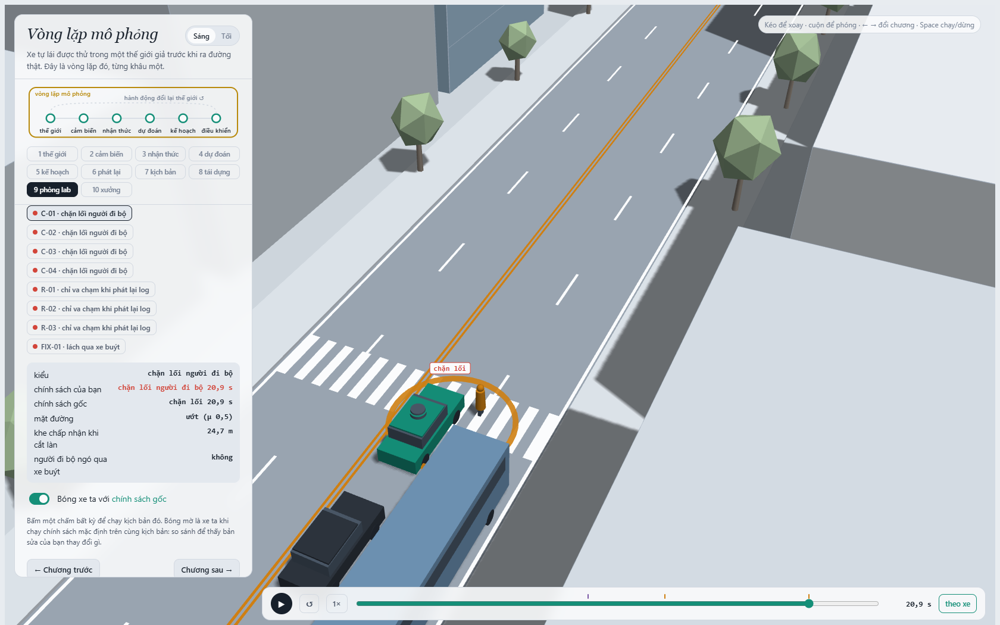
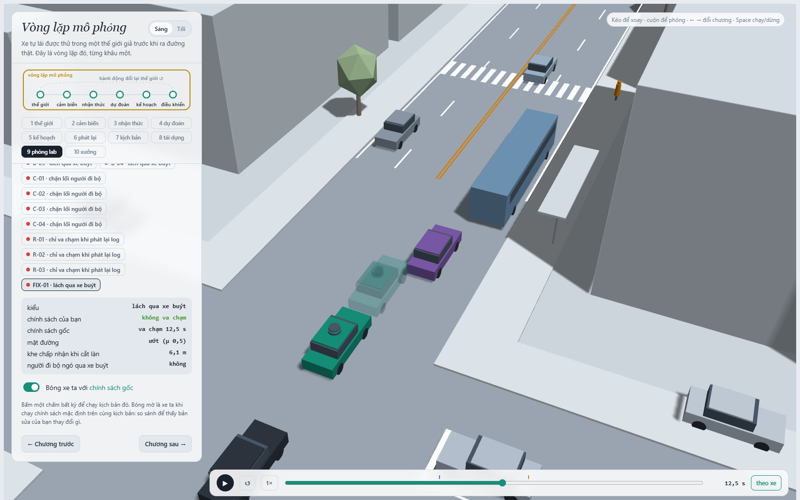
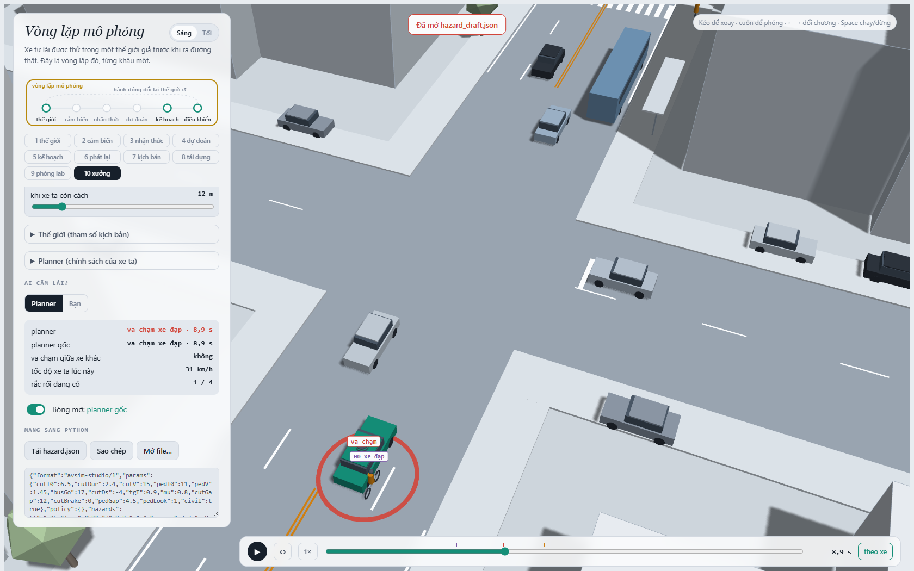
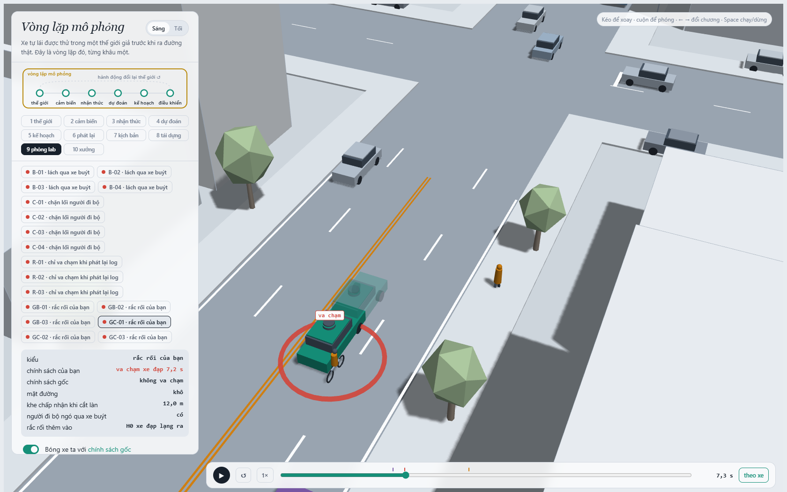

MSSV: 202602763

# Lab 11 · Scenario Forge — báo cáo

Mỗi câu: trả lời ngắn, **trích số từ `evidence/`** (ghi tên file và trường, ví dụ `mc.json: crashes = 4`). Grader chạy lại với MSSV của bạn; số không khớp `evidence/` thì mất điểm phần D (RUBRIC), và câu dựa trên số sai khó được điểm đầy đủ. Không cần văn hay: một bảng nhỏ và hai, ba câu giải thích là đủ.

Thị trấn của bạn (`meta.json: _run.town`): B

## 1. Phát lại log có trung thực không? (bước A)

`replay.json`: 400 kịch bản, không log nào bị loại do người lái va chạm, nên n_used=400. Replay có **121** va chạm (rear=110, side=11), reactive có **0**; crash_in_both=0. Đây là quan sát trên 400 kịch bản, không chứng minh planner không bao giờ va chạm.

Trong replay, tác nhân khác đi đúng quỹ đạo log của người lái, không phản ứng với việc planner phanh sớm hơn. Xe sau có thể đi vào xe ego đã giảm tốc dù trong thế giới phản ứng nó sẽ phanh theo; 110/121 va chạm replay thuộc rear. Bản world mặc định cũng có ego–TG contact giả tại t=14,8 s.

Ví dụ replay_only[0] là scenario=1, contact=side; reactive không va chạm và min_ttc_reactive=7,46063 s. Cần xem chương 9 sau export để mô tả chính xác chuỗi chuyển động của ví dụ này; chưa suy diễn tác nhân chỉ từ contact=side.

## 2. Kịch bản bất khả thi (bước B)

`lab11/feasible.py` loại: gia tốc ngang chuyển làn (π/cutDur)^2×3,5/2 vượt μg; cutBrake vượt μg; pedV>2,5 m/s; cutV ngoài (0;22] m/s. Ngoài ra đầu vào phải hữu hạn, cutDur và μ dương. Hai luật đầu dựa trên giới hạn ma sát, luật sau giới hạn miền tốc độ của mô hình dạy học, không phải hằng số vật lý áp dụng cho mọi người đi bộ/xe.

CEM chọn kịch bản nguy hiểm nên dễ bị kéo về chuyển làn quá gấp hoặc phanh vượt ma sát. Nếu đếm những kịch bản đó là thất bại, ước lượng sẽ tính thêm các tình huống nằm ngoài miền khả thi đã định nghĩa. Theo hunt.json, crosswalk_block loại nhiều nhất: 28/2400 kịch bản; bus_bypass=2, cut_in=2, rear_ended=7. Tổng MC có 22 đầu vào bất khả thi được loại khỏi mô phỏng. Không dùng số đếm CEM làm tần suất tự nhiên.

## 3. Monte Carlo cho bạn biết gì (bước C1)

`mc.json`: k=3, n=3000, p̂=0.001000; Wilson 95%=[0.000340141; 0.002936197]. Cả 3 vụ đều bus_bypass. Với p≈0,001, công thức xấp xỉ n≈96/p cho sai số ±20% tương đối cần **96.000** lượt, khoảng 32 lần ngân sách MC hiện tại. Đây là dự trù dựa trên p̂ còn rất bất định.

Các kiểu cut_in, crosswalk_block, rear_ended và other chưa xuất hiện trong MC. Không báo xác suất thật bằng 0: mỗi kiểu có Wilson upper=0.001278896 với 0/3000 lượt. Phân biệt số đếm quan sát 0 với cận trên xác suất. MC không thay thế cuộc săn các kiểu hiếm.

## 4. Importance sampling, ESS và độ suy biến (bước C3)

| Seed | Kiểu | p ước lượng | Hits | ESS | top_share |
|---:|---|---:|---:|---:|---:|
| 0 | bus_bypass | 0.0017681 | 51 | 127.15 | 0.4968 |
| 0 | cut_in | 0 hit; upper=0,025 | 0 | 118.49 | 0.0000 |
| 0 | crosswalk_block | 3.40515e-06 | 106 | 138.61 | 0.5027 |
| 0 | rear_ended | 0 hit; upper=0,025 | 0 | 106.14 | 0.0000 |
| 1 | bus_bypass | 0.00087529 | 57 | 129.99 | 0.4156 |
| 1 | cut_in | 0 hit; upper=0,025 | 0 | 108.32 | 0.0000 |
| 1 | crosswalk_block | 1.27161e-06 | 129 | 113.18 | 0.2885 |
| 1 | rear_ended | 0 hit; upper=0,025 | 0 | 133.82 | 0.0000 |
| 2 | bus_bypass | 0.000827008 | 47 | 123.30 | 0.3009 |
| 2 | cut_in | 0 hit; upper=0,025 | 0 | 125.76 | 0.0000 |
| 2 | crosswalk_block | 0.000506485 | 107 | 119.69 | 0.9949 |
| 2 | rear_ended | 0 hit; upper=0,025 | 0 | 131.32 | 0.0000 |

Tổng ước lượng qua ba seed lần lượt 0.00177150, 0.00087656, 0.00133349; trung vị **0.00133349**, so với MC 0,001. Các tổng chênh nhau khoảng 2.02 lần; khoảng báo bởi pipeline chồng nhau và bao giá trị MC, nhưng không đủ để xác nhận hai phương pháp đã chính xác.

`top_share` là phần tổng w*y do một mẫu lớn nhất đóng góp. Crosswalk_block seed 0 có top_share=0,5027 và seed 2 **0,9949**: gần 99,49% estimate seed 2 do một mẫu quyết định. Seed 2 p≈5,06e-4 cao hơn seed 1 p≈1,27e-6 khoảng 398 lần dù hits gần nhau (107 và 129). ESS đo độ lệch của toàn bộ trọng số, không đo trực tiếp số mẫu lỗi hữu ích. top_share thấp cũng không chứng minh proposal đã bao phủ mọi vùng lỗi.

Budget=16.800 gồm 9.600 mẫu săn + 7.200 mẫu IS (4 kiểu×3 seed×600); chưa gồm MC 3.000 dùng cho other. MC muốn khoảng ±20% tương đối tại p≈0,001 cần xấp xỉ 96.000 lượt. Với crosswalk_block p≈1,27e-6 theo seed 1, cùng công thức cho khoảng 75 triệu lượt; đây chỉ là dự trù rất nhạy theo p. **Không nói IS đã đạt cùng độ chính xác ±20%**: ví dụ bus_bypass seed 1 có 1,96*se/p≈86,7%, còn crosswalk_block seed 2 có relative half-width≈195%. IS tìm được nhiều lỗi hơn trong ngân sách nhỏ nhưng kết quả còn suy biến.

`other` lấy từ MC: 0/3000 quan sát, Wilson upper=0,001278896; pipeline không săn other vì không có một điểm nguy hiểm chung đáng tin cho phần dư. Chưa thấy other không có nghĩa p thật bằng 0.

Cut_in và rear_ended đều zero-hit trong ba seed; dùng **upper_zero_hits=3/(0,2×600)=0,025** cho từng kiểu/seed, không dùng hi=0 của xấp xỉ Gaussian và không thay n bằng ESS. Các khoảng tổng lo/hi trong estimate.json cộng phần other nhưng không cộng các cận zero-hit này cho mọi mode; vì vậy không gọi hi tổng là chứng nhận 95% cho tất cả kiểu chưa thấy. Stage 5 fix có cơ chế fail_hi riêng để xử lý kiểu unseen.

## 5. Các kiểu thất bại (bước C2 + 3D)

| Cuộc săn | Các kiểu tìm được | Bất khả thi bị loại |
|---|---|---:|
| bus_bypass | {'bus_bypass': 163} | 2 |
| cut_in | {'bus_bypass': 30, 'crosswalk_block': 2} | 2 |
| crosswalk_block | {'crosswalk_block': 64, 'bus_bypass': 1} | 28 |
| rear_ended | {'bus_bypass': 36, 'crosswalk_block': 3} | 7 |

Mỗi cuộc săn có 8 vòng × 300 mẫu; cloud.json có 9600 điểm gồm cả đầu vào bị loại. Hai cuộc săn đúng đích bus_bypass và crosswalk_block tìm được lần lượt 163 và 64 thất bại đúng kiểu. Cuộc săn cut_in/rear_ended chưa tìm thấy thất bại đúng đích; chúng lại tìm được các kiểu khác. Điều này không chứng minh hai kiểu đó không tồn tại. Một cuộc săn chung có thể co về kiểu dễ tìm và bỏ qua các cơ chế khác. Ảnh dưới chụp viewer gốc chương 9, dùng tham số nguyên độ chính xác từ evidence/viewer.json, không dùng mẫu giảng viên. Trong hai ảnh lỗi, xe đặc được pin ở policy gốc của cuộc săn, bóng mờ là policy sửa; nhãn UI cố định “chính sách của bạn/gốc” có thể đảo nghĩa trong chế độ run được pin. Ảnh FIX-01 ở câu 6 dùng policy sửa làm xe chính và policy gốc làm bóng, khớp nhãn UI.

**Bus bypass, B-01:** xe C2 lách qua xe buýt đỗ và lấn sang làn ego. Trên đường ướt μ=0,5, khe chấp nhận 6,1 m, policy gốc nhận xe lấn là leader quá muộn và chạm C2 lúc **t=12,45 s**. Tại sự kiện C2 x=95,28 m, v=1,09 m/s; ego x=90,76 m, v=5,02 m/s. C2 thỏa điều kiện x<112, v<6 của mode bus_bypass.

**Crosswalk block, C-01:** người đi bộ không ngó qua xe buýt (pedLook=0), xuất hiện trên vạch; ego phanh và đứng lại nhưng thân xe chắn đường đi. Sự kiện **kind=block tại t=20,9 s**, không phải người đi bộ bước vào thân xe: ego x=119,73 m và P1 x=122 m, cả hai v=0. Bản sửa cutinLat không giải quyết được cảnh này; bóng và xe chính cùng chặn lối.

## 6. Sửa planner (bước E + 3D)

`fix.json`: chọn **cutinLat=3,0 m** (gốc 2,15 m), các núm còn lại giữ mặc định. Bộ chọn chỉ dùng table TRAIN: đủ tiến độ ≥95% baseline_train, sau đó tối thiểu fail_hi, hòa thì ưu tiên tiến độ cao hơn. 12 ứng viên dùng cùng TRAIN draws. Đã đối chiếu choose_policy chạy lại trên table cho đúng chosen; không chọn lại theo TEST.

| Tập / policy | fail | fail_hi_seen | fail_hi | Tiến độ m | Frame phanh gấp trung bình |
|---|---:|---:|---:|---:|---:|
| TRAIN gốc | 0.0020632338 | 0.0036233425 | 0.0036233425 | 219.9791 | 7.6016 |
| TRAIN chọn | 1.4358707e-06 | 2.2340737e-06 | 2.2340737e-06 | 219.9605 | 7.4805 |
| TEST gốc | 0.0006906345 | 0.0012386843 | 0.00251758 | 213.7865 | 8.5803 |
| TEST chọn | 3.8243457e-08 | 7.5920836e-08 | 0.038778972 | 213.6267 | 8.2473 |

TEST dùng seed mới, săn lại cho từng policy và tập tự nhiên riêng 3000 kịch bản. Mất tiến độ **0.0747%** so policy gốc TEST, dưới 5%. harsh là **số frame a<−3 m/s² trung bình mỗi kịch bản**, không phải số lần bắt đầu một đợt phanh riêng biệt. Quãng đường dừng tính tại va chạm, không cộng phần chạy tiếp sau đó.

Bản sửa có fail rất nhỏ nhưng bus_bypass zero-hit, nên TEST cộng **3/(0,2×400)=0,0375** cho mode này; phần other zero/3000 cộng Wilson upper=0,001278896. Vì vậy fail_hi≈0,038779 lớn hơn fail_hi gốc≈0,002518 và lớn hơn cả point fail của gốc. Điều đó không chứng minh bản sửa kém hơn: ngân sách chỉ đủ quan sát xu hướng, chưa đủ chứng nhận đã loại lỗi hiếm. Không dùng fail_hi_seen≈7,59e-8 như cận an toàn đầy đủ của policy. Với yêu cầu riêng một mode zero-hit upper<1e-3, cần trên 15000 mẫu của mixture này.

Ảnh FIX-01 dùng **cùng tham số B-01**, policy sửa làm xe chính và policy gốc làm bóng mờ. Ego sửa nhận xe lấn là leader sớm hơn; không có ego-event trong rollout 24 s, trong khi bóng policy gốc chạm C2 lúc 12,45 s. File viewer_capture.json chỉ thêm run so sánh, không thay thế evidence/viewer.json chính thức hoặc thay tham số thế giới.

Ví dụ núm nghe an toàn hơn: T=2,0 (gốc 1,6) cho TRAIN fail≈0,00274, hi≈0,00563, cao hơn gốc TRAIN fail≈0,00206, hi≈0,00362. Khoảng còn rộng, chưa chứng minh tăng xác suất thật. Một cơ chế khả dĩ là ego chừa khe lớn hơn khiến xe khác chấp nhận cắt vào, rồi phanh/nhường lại tạo tình huống khác; đây là giả thuyết về tương tác, không kết luận nhân quả chỉ từ bảng. cautionV=5 cũng giảm tiến độ xuống 175,6 m, không qua ràng buộc tiến độ. Không sửa policy theo số TEST công khai.

## 7. Từ mô phỏng ra đường thật

Phân phối tự nhiên trong `space.py` là giả định. Chọn **ba** giả định ảnh hưởng nhiều nhất đến con số của bạn (ví dụ khe chấp nhận của xe chuyển làn, tỉ lệ người đi bộ ngó qua xe buýt, ma sát đường ướt). Với mỗi cái: dữ liệu thật nào sẽ thay nó, lấy từ đâu, và nếu nó sai thì con số của bạn sai theo hướng nào?

## 8. Giới hạn

Ba điều mà xác suất bạn báo **không** nói, ví dụ: thế giới chỉ có một con phố; người lái chỉ là IDM; cảm biến hoàn hảo trừ phần bị xe buýt che. Nếu được thêm một tuần, bạn sẽ đo gì tiếp?

## 9. Rắc rối của bạn (bước G + chương 10)

**Rắc rối:** một xe đạp ở E2 lạng sang E1 khoảng một bề rộng làn (3,0–3,6 m), mô phỏng tránh một chướng ngại ở làn bên. Không khẳng định có ổ gà/xe đỗ trong model nếu không có actor đó: đó là động cơ ngoài đời để thiết kế card. Cảnh được nhập rồi xuất lại bằng chương 10; file `hazard.json` giữ format, params, policy và hazards đầy đủ. Cảnh cụ thể gốc có ego–H0 contact ở **8,9 s**, JS và Python cùng thời điểm.

**Thiết kế và căn cứ:** một grid thử 18 trường hợp xe đạp trước đánh giá đã tìm thấy các va chạm tránh được, sau đó chốt space và không đổi sau mine. x=10–40 m là lân cận vị trí dựng x=25 m trên đoạn thẳng; trig=10–18 m thử sự lạng gần xe, không phải phân phối khe thực nghiệm. v=3,5–4,5 m/s (12,6–16,2 km/h) nằm trong khoảng quan sát 12–20 km/h được thảo luận trong [FHWA-HRT-05-137, chương 2](https://www.fhwa.dot.gov/publications/research/safety/pedbike/05137/chapter2.cfm). Nguồn này chỉ hỗ trợ độ lớn tốc độ, không chứng minh khoảng uniform hay tần suất cho thị trấn mô phỏng. swDur=2,7–3,0 s đảm bảo a_lat tối đa π²×3,6/(2×2,7²)≈2,44 m/s², dưới giới hạn 3 m/s² của studio; quãng lạng lấy từ bề rộng làn mô phỏng 3,5 m. Chi tiết có trong hazard.json: why.

**Miền suy luận:** dùng `world: scene`, giữ nguyên giao thông của cảnh và quét 5 trường hazard. `exposure=1` nghĩa một card được chèn vào mỗi episode do thiết kế, **không phải** tần suất mỗi chuyến ngoài đời. Pipeline không sinh per_trip và không nhân exposure để so với bus_bypass của town B. Cần thống kê gặp xe đạp trên tuyến và quỹ đạo thực tế mới suy ra rủi ro mỗi chuyến. Đây là lựa chọn thử nghiệm có điều kiện được README cho phép, không thay đổi phân phối town B hoặc seed.

**Kết quả:** accepted=1500/1500=100%; không có overlap lúc bắt đầu, không kịch bản bất khả thi. Mỗi policy đánh giá trên cùng 1500 biến thể bằng seed của đề.

| Policy | n | Va chạm | Avoidable | Unavoidable | Unattributed | Low-speed | Foreknown avoidable | p lỗi có điều kiện | Wilson 95% |
|---|---:|---:|---:|---:|---:|---:|---:|---:|---|
| Gốc | 1500 | 1070 | 1070 | 0 | 0 | 0 | 1070 | 0.713333 | [0.689926; 0.735650] |
| cutinLat=3,0 | 1500 | 577 | 577 | 0 | 0 | 3 | 577 | 0.384667 | [0.360370; 0.409553] |

Policy sửa giảm lỗi có điều kiện từ 0,713333 xuống 0,384667, chênh lệch tuyệt đối 0,328667, giảm tương đối **46.07%** trong dải thử này. Vẫn còn 577 lỗi tránh được, nên bản sửa stage 5 không giải quyết đầy đủ hazard xe đạp. Ba va chạm low_speed của bản sửa vẫn nằm trong avoidable, không cộng thêm lần nữa. Không có khoảng cách giữa avoidable và avoidable_foreknown trong lượt này; không suy rộng thành che khuất không quan trọng ở cảnh khác.

**Oracle và diễn giải:** avoidable là phanh tối đa ngay khi hazard bắt đầu và nhìn thấy, với tiền tố rollout giống planner gốc. Phản ứng tức thì và hiểu đúng nguy cơ là lạc quan, có thể đếm nhiều lỗi hơn mức planner thực tế tránh được. Ngược lại oracle chỉ thử phanh, chưa thử đánh lái, nên có thể bỏ sót cách tránh khác. Các tỷ lệ trên là nhãn theo chuẩn oracle, không phải ground truth an toàn thực địa.

**Ảnh cảnh gốc, chương 10:**

**Ảnh một lỗi còn lại của policy sửa, GC-01:** chạm H0 lúc 7,2 s; hazard bắt đầu và oracle bắt đầu phanh lúc 5,4 s theo mine.json: chosen.examples[0]. Tham số này lấy nguyên từ biến thể của cuộc quét, không phải cảnh exact 8,9 s.

**Tự lái:** chưa thực hiện thử nghiệm người lái; không có egoAcc và không khẳng định bản thân tránh được.

**Đề xuất sửa tiếp:** thêm dự đoán hành lang chiếm chỗ theo vận tốc ngang của bike, tính time-to-lane-entry trước khi khoảng ngang rơi vào ngưỡng leader; giảm tốc nếu hành lang bike giao đường ego trong horizon ngắn. Chỉ tăng cutinLat là heuristic hữu ích nhưng không bao phủ chuyển động ngang liên tục. Chưa triển khai hoặc chọn lại policy trên dữ liệu mine để tránh báo một phép sửa hậu nghiệm như kết quả đã đo.
